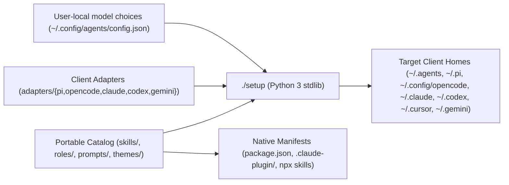

# agents

Plug-and-play catalog of portable engineering skills, specialized role
definitions, client adapters, prompt templates, themes, inert MCP examples, and
a zero-dependency Python 3 installer (`./setup`).

## Architecture



## Catalog Contents

| Category | Count | Path | Notes |
| --- | --- | --- | --- |
| Packs | 8 | `packs.json` | `core`, `delivery`, `review`, `architecture`, `implementation`, `qa-testing`, `operations`, `research` |
| Skills | 12 | `skills/` | Git, commit, PR triage/merge, diff guide, report card, AGENTS.md |
| Roles | 51 | `roles/<category>/` | 36 read-only review/analysis roles + 15 mutating roles; one is Pi-only |
| Pi Prompts | 4 | `prompts/` | Deep code review, security audit, test review, decomposition |
| OpenCode Commands | 8 | `adapters/opencode/commands/` | Slash-command workflows for commit, issue, PR, handoff, release |
| Pi Theme | 1 | `themes/` | `violet-orbit.json` |
| Claude Extras | 2 | `adapters/claude/` | `visual-concise` output style and `visual-reminder.sh` hook |
| Inert MCP Examples | 4 | `mcp/examples/` | Placeholders only (`${ENV_VAR}` and `<pinned-version>`) |

### Category Packs

| Pack | Skills | Roles | Prompts | Commands | Focus |
| --- | --- | --- | --- | --- | --- |
| `core` | 0 | 2 | 0 | 0 | General-purpose fallback and read-only codebase exploration; added to every pack install |
| `delivery` | 8 | 0 | 0 | 5 | Commit, branch, review-triage, tag, and ship changes |
| `review` | 4 | 9 | 4 | 2 | Report-only correctness, security, maintainability, architecture, test, doc, comment, compatibility, and observability reviews |
| `architecture` | 0 | 9 | 0 | 1 | Requirements, boundaries, interfaces, data models, threat models, and change and migration plans |
| `implementation` | 0 | 9 | 0 | 0 | Mutating features, fixes, refactors, performance, build, docs, observability, and static analysis |
| `qa-testing` | 0 | 13 | 0 | 0 | Test strategy and engineering, prompt evals, and browser, terminal, mobile, desktop, a11y, usability, and l10n QA |
| `operations` | 0 | 7 | 0 | 0 | CI watching and triage, release readiness, incident RCA, dependency risk, Cloudflare inspection, and Pi startup profiling |
| `research` | 0 | 2 | 0 | 0 | Current web research and version-scoped library documentation |

## Quick Start

### Option 1: Native Client Installers

```sh
# Cross-client skills installation
npx skills add sagmans/agents

# Pi package installation (skills, prompts, theme)
pi install git:github.com/sagmans/agents

# Claude Code plugin marketplace
/plugin marketplace add sagmans/agents
/plugin install sagmans-agents@sagmans-agents-marketplace
```

### Option 2: Zero-Dependency `./setup` CLI

Preview or install across Pi, OpenCode, Claude Code, Codex, Cursor, and Gemini
CLI without runtime package dependencies:

```sh
git clone https://github.com/sagmans/agents.git
cd agents

# Interactive menu
./setup

# Preview full deployment first
./setup --all --dry-run

# Install all assets across supported clients, plus Claude styles
./setup --all --styles

# Selective install by category pack, asset ID, or snapshot copy
./setup --pack delivery --pack review --client claude
./setup --client opencode --skill pr-digest --role architecture-reviewer
./setup --client codex --skill commit --copy

# Inspect packs, drift, or cleanly remove managed entries
./setup list --kind packs
./setup status
./setup uninstall
```

### Choosing Models

The catalog ships no provider or model names. A role renders with no `model`
field, so each client uses its own default, until you choose a model. Choices
live in a user-local file, `$XDG_CONFIG_HOME/agents/config.json` (by default
`~/.config/agents/config.json`, mode `0600`), never in this repository.
Install, status, and render read it automatically.

```sh
./setup models                     # show the file path and every choice
./setup models edit                # choose interactively
./setup models set --client pi --model <provider/model> --thinking high
./setup models set --client pi --category review --thinking max
./setup models set --client opencode --role feature-implementer --model <id>
./setup models clear --client pi --role feature-implementer
./setup models import my-models.json   # merge a file with the same schema
./setup --all --no-config          # ignore the file for one run
```

A role choice overrides a category choice, which overrides the client-wide
choice; each field (`model`, `thinking`) merges on its own, and `set` or
`import` change only the fields they name. A choice for a role or category the
catalog no longer has stops install and render with an error; `models show`
marks it and `models clear` removes it. A `--config` path that does not exist
is an error, not an empty config. `thinking` applies
to Pi only. Non-interactive runs never add a model on their own. See
[Model choices](docs/compatibility.md#model-choices) for the file schema.

Pi skills installed with `./setup --client pi` go to `~/.agents/skills`, which
Pi discovers directly. Roles, prompts, and themes remain under `~/.pi/agent`.
Existing duplicate skills are not moved automatically; see the
[shared skills migration guidance](docs/compatibility.md#shared-pi-skills).

## Documentation and Security

- [Client Compatibility Matrix](docs/compatibility.md)
- [Security Model & Guardrails](docs/security-model.md)
- [Authoring Contract](docs/authoring.md)
- [Public Sibling Ecosystem](docs/ecosystem.md)
- [Inert MCP Examples Guide](mcp/README.md)
- [Security Policy](SECURITY.md)

## Verification

Install local hooks once per clone and run strict static, security, catalog,
skill, and clean-room dogfood checks:

```sh
./scripts/setup-hooks
make check
```

## License and Contributions

This repository is licensed under the MIT License (`LICENSE`). Use it directly
or fork it to fit your own workflow. External contributions and pull requests
are not accepted for this upstream repository.
