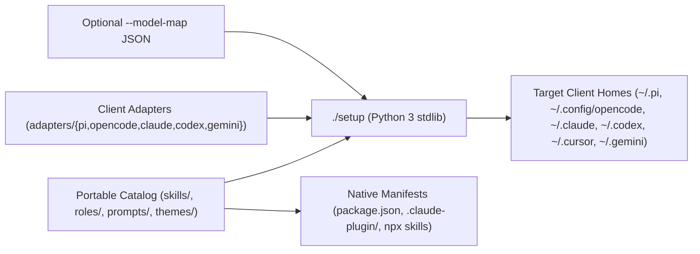

# agents

Plug-and-play catalog of portable engineering skills, specialized role
definitions, client adapters, prompt templates, themes, inert MCP examples, and
a zero-dependency Python 3 installer (`./setup`).

## Architecture



## Catalog Contents

| Category | Count | Path | Notes |
| --- | --- | --- | --- |
| Skills | 12 | `skills/` | Git, commit, PR triage/merge, diff guide, report card, AGENTS.md |
| Roles | 58 | `roles/` | 43 read-only review/analysis roles + 15 mutating engineering roles |
| Pi Prompts | 4 | `prompts/` | Deep code review, security audit, test review, decomposition |
| OpenCode Commands | 8 | `adapters/opencode/commands/` | Slash-command workflows for commit, issue, PR, handoff, release |
| Pi Theme | 1 | `themes/` | `violet-orbit.json` |
| Claude Extras | 2 | `adapters/claude/` | `visual-concise` output style and `visual-reminder.sh` hook |
| Inert MCP Examples | 4 | `mcp/examples/` | Placeholders only (`${ENV_VAR}` and `<pinned-version>`) |

## Quick Start

### Option 1: Native Client Installers

```sh
# Cross-client skills installation
npx skills add sagmans/agents

# Pi package installation (skills, prompts, theme)
pi install git:github.com/sagmans/agents

# Claude Code plugin marketplace
/plugin marketplace add sagmans/agents
/plugin install sagmans-agents@sagmans-agents-marketplace
```

### Option 2: Zero-Dependency `./setup` CLI

Preview or install across Pi, OpenCode, Claude Code, Codex, Cursor, and Gemini
CLI without runtime package dependencies:

```sh
git clone https://github.com/sagmans/agents.git
cd agents

# Interactive menu
./setup

# Preview full deployment first
./setup --all --dry-run

# Install all assets across supported clients (with optional model map & Claude styles)
./setup --all --styles --model-map adapters/pi/model-map.example.json

# Selective install or snapshot copy instead of symlinks
./setup --client opencode --skill pr-digest --role architecture-reviewer
./setup --client codex --skill commit --copy

# Inspect drift or cleanly remove managed entries
./setup status
./setup uninstall
```

## Documentation and Security

- [Client Compatibility Matrix](docs/compatibility.md)
- [Security Model & Guardrails](docs/security-model.md)
- [Authoring Contract](docs/authoring.md)
- [Public Sibling Ecosystem](docs/ecosystem.md)
- [Inert MCP Examples Guide](mcp/README.md)
- [Security Policy](SECURITY.md)

## Verification

Install local hooks once per clone and run strict static, security, catalog,
skill, and clean-room dogfood checks:

```sh
./scripts/setup-hooks
make check
```

## License and Contributions

This repository is licensed under the MIT License (`LICENSE`). Use it directly
or fork it to fit your own workflow. External contributions and pull requests
are not accepted for this upstream repository.
